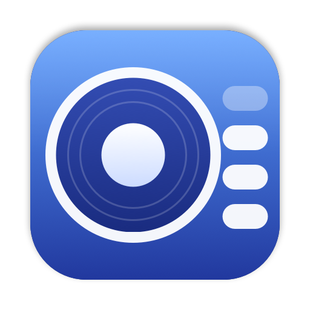

<p align="center"></p>

<h1 align="center">OpenMixer</h1>

<p align="center">
  <b>An open-source macOS menu-bar audio mixer.</b><br>
  Per-app volume, EQ and Audio Unit effects, per-app output routing, device control, hotkeys and level meters.
</p>

<p align="center">
  
  
  
</p>

<p align="center"><a href="README.es.md">Leer en español</a></p>

---

macOS gives you one volume slider for everything. OpenMixer lives in the menu bar and lets you turn Spotify down while a
video call stays loud, send a game to your headphones and music to the speakers, EQ a single app, or run a mastering plugin
over all system audio. It is written in Swift/SwiftUI on top of Core Audio process taps, with no kernel extension or virtual audio driver.

> **Not affiliated.** OpenMixer is an independent project with original code, name, icon and design. It is not made by, endorsed by or
> connected to Rogue Amoeba or any other commercial audio-mixer vendor; all product names belong to their owners.

## Features

**Menu-bar icon**
- Mirrors the system output volume: four pills light up as you raise it and all dim when muted.
- Scroll over it to change the volume, ⌥-click to mute, right-click for a menu.
- Pinned to the right-most slot next to the system icons.

**Devices**
- Choose the default **output**, **input** and **system-sounds** device; per-device volume, mute and live level meter.
- AirPlay picker; connect or disconnect paired **Bluetooth** audio devices from the window.
- Sample-rate picker, maximum-volume limit, hide devices you never use.
- **Software volume** for devices with missing or unreliable hardware volume (HDMI, some DACs).
- Brief mute when the output changes, so switching to speakers never blasts you.

**Per-app control**
- Volume 0–200 %, mute, level meters, favourites, and an exclusion list.
- Send any app to a different output device.
- Apps are only intercepted once you change something, so untouched audio plays natively.

**Effects** (per app *and* per device)
- 10-band equalizer with built-in presets and your own saved presets.
- Headphone correction: import an [AutoEQ](https://github.com/jaakkopasanen/AutoEq) `ParametricEQ.txt` (peak and shelf filters, preamp).
- Host any installed **Audio Unit** effect (Apple or third-party) with its own editor window; state is saved.
- Balance, limiter, bypass.

**Control**
- Global shortcut to open the mixer; volume up/down/mute shortcuts per output device.
- Keyboard volume keys for devices macOS can't control natively.
- **Quick Configs**: save and restore the whole mixer state in one click.
- Settings: *General* (including **Open at login**), *Devices*, *Hotkeys*, *Applications*, *Advanced*.
- Native look: Liquid Glass on macOS 26+, follows light/dark mode, smooth animations and haptics.

## Requirements
- macOS **14.2** or later on **Apple silicon** (Core Audio process taps). Liquid Glass styling needs macOS 26; older versions use a standard material.
- A Swift toolchain to build from source. The Xcode **Command Line Tools** are enough; full Xcode is not required.

## Install

### Download (recommended)
Grab **`OpenMixer-<version>.dmg`** from the [latest release](https://github.com/PabloJuGo/OpenMixer/releases/latest), open it and drag *OpenMixer* to *Applications*.
It is a native **Apple silicon** build (macOS 28 no longer runs Intel code, so no Intel slice is shipped; Intel users can build with `UNIVERSAL=1 scripts/bundle.sh`). Verify the download with `shasum -a 256 -c SHA256SUMS.txt` if you like.

The app is **ad-hoc signed, not notarized** (there is no paid Apple Developer ID behind this project), so the first launch is blocked by Gatekeeper:
- **Right-click** *OpenMixer* → **Open** → **Open**, or
- run `xattr -dr com.apple.quarantine /Applications/OpenMixer.app` once.

If you'd rather not trust a binary, build it yourself:

```sh
git clone https://github.com/PabloJuGo/OpenMixer.git
cd OpenMixer
scripts/bundle.sh --install     # builds, ad-hoc signs and copies to /Applications
open /Applications/OpenMixer.app
```

`scripts/bundle.sh` alone writes `build/OpenMixer.app`; `scripts/release.sh` builds the `.dmg` and `.zip`. Installing to `/Applications` is recommended
because *Open at login* works best from there.

### Permissions
| Permission | Why | When it is asked |
|---|---|---|
| **Audio capture** | Core Audio process taps are how per-app volume/EQ works | First time a tap is created (changing an app, or opening the window for meters) |
| **Bluetooth** | List and connect paired audio devices | First time the window opens |
| **Accessibility** *(optional)* | Intercept the keyboard volume keys | Only if you enable *keyboard volume keys* in Hotkeys |

The app is ad-hoc signed, so macOS may ask again after you rebuild it. Nothing leaves your machine: OpenMixer has no network code.

## Usage
- **Click** the menu-bar icon to open the mixer; click anywhere outside (or press Esc) to dismiss it, or **pin** it to keep it above other windows.
- Drag an app's slider; the knob snaps to 100 %. The mute button and the sliders icon (effects) sit on the right of each row.
- In **Effects** pick *EQ*, *Headphones*, *Plugins* or *Output* (balance, limiter, output device; sample rate and software volume for devices).
- Right-click an app row to favourite, reset or exclude it.
- Settings are stored in `~/Library/Application Support/OpenMixer/state.json`.

## How it works
- For each app you change, OpenMixer creates a `CATapDescription` **process tap** (muted-when-tapped) and a private aggregate device
  around the chosen output. A real-time IO proc replays the captured audio through
  `gain/balance → EQ → headphone profile → Audio Units → limiter` (`Sources/MixerCore`).
- Device-level effects and software volume use a **device-wide tap** that excludes OpenMixer itself and any app handled by its own tap, so audio is never processed twice and there is no feedback loop.
- Audio Units are driven through the classic `AudioUnitRender` API from a separate chain per tap; the editor window uses a second instance and publishes its `fullState` back into the settings.
- The real-time path has no allocation and takes only try-locks, so UI edits never block the audio thread (a collision skips filtering for one buffer).
- Taps are created off the main thread (the first one can wait on the permission prompt) and torn down when settings return to default.

## Project layout
```
Sources/MixerCore    audio engine, no UI: Core Audio helpers, taps, processor, filters, plugin host, settings model
Sources/OpenMixer    the app: status item/popover, SwiftUI views, settings window, model
Sources/SelfCheck    test executable (DSP, models, buffer layouts, Audio Unit hosting, live audio)
scripts/             bundle.sh (build + sign + install), release.sh (.dmg/.zip), live-check.sh, make_icon.swift
Resources/           app icon
```

## Testing
XCTest and Swift Testing are not part of the Command Line Tools, so the checks are a plain executable:

```sh
swift run SelfCheck       # DSP, settings round-trips, Core Audio buffer layouts, Audio Unit hosting, device enumeration
scripts/live-check.sh     # end-to-end with real audio: plays a quiet 440 Hz tone and verifies per-app and device-wide taps
```
`live-check.sh` asks once for audio-capture permission. Two debug flags help with UI work:
`OpenMixer --snapshot DIR` renders the pages to PNG and `OpenMixer --popover-test` checks that the popover size follows each page and that nothing overflows.

## Troubleshooting
- **An app goes silent after I change it:** audio-capture permission was denied. Allow *OpenMixer* in *System Settings › Privacy & Security › Screen & System Audio Recording* (or *Audio Recording*), then toggle the app slider again.
- **The permission prompt reappears after rebuilding:** ad-hoc signatures change on every build; install once with `scripts/bundle.sh --install`.
- **Keyboard volume keys do nothing:** enable the option in *Settings › Hotkeys* and allow OpenMixer under *Privacy & Security › Accessibility*.
- **An app is missing from the list:** only apps that currently hold a Core Audio client appear; start playback and it shows up. Check *Settings › Applications* in case it is excluded.

## Known limits
- Audio Unit **v3** (out-of-process) editors work, but state sync depends on the plugin publishing `fullState`.
- Helper processes are grouped under their app with a private libsystem call (`responsibility_get_pid_responsible_for_pid`) when available, otherwise by bundle-id prefix.
- Meters for apps you haven't modified use an extra non-muting tap.
- Not implemented: per-app input capture, a soft-knee/look-ahead limiter, bundled headphone profiles (import your own), localisation (UI is English).

## Contributing
Issues and pull requests are welcome. Please run `swift run SelfCheck` before sending a change, and `scripts/live-check.sh` if you touch the audio path.
Keep the real-time code (`Processor`, `FilterBank`, `PluginChain`, `Render`) free of allocation, locks and Swift runtime calls that can block.

## License
[GPL-3.0](LICENSE)
